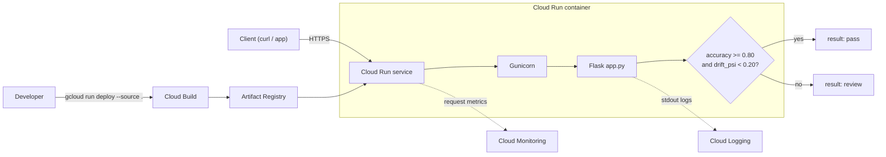
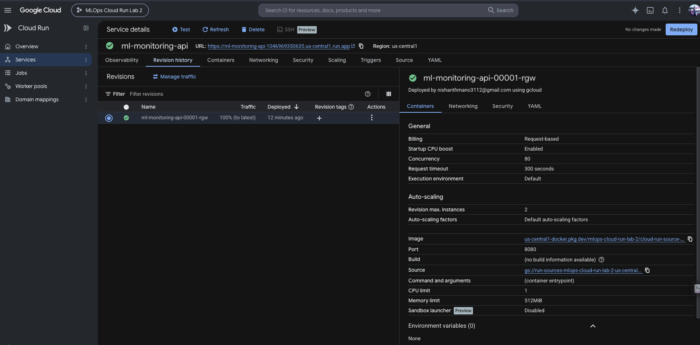
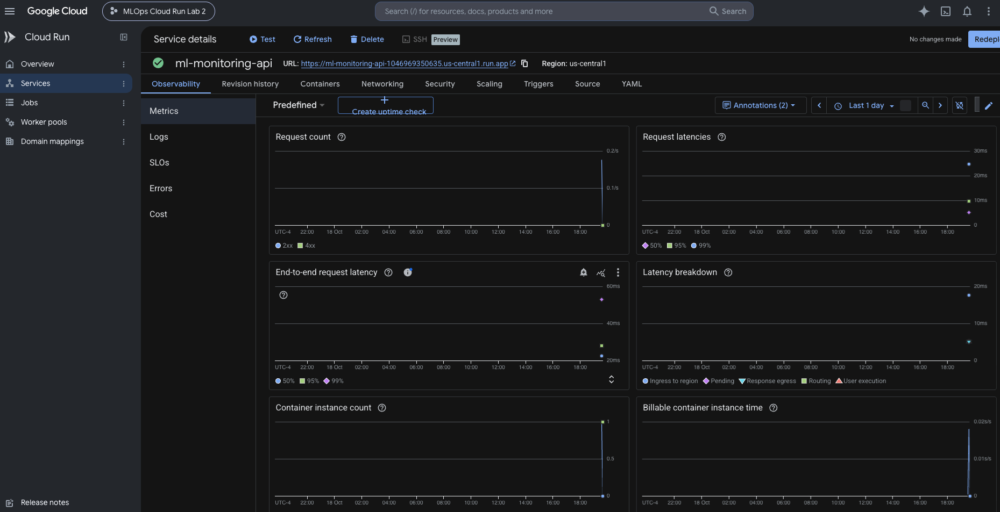

# Lab 2: ML Model Monitoring REST API on Google Cloud Run

A small Flask service that checks model metrics against configurable thresholds, packaged in Docker and ready for Google Cloud Run. It is my version of the Professor's [Cloud Run Beginner Lab](https://github.com/raminmohammadi/MLOps/tree/main/Labs/GCP_Labs/Cloud_Runner_Labs/Begineer_Lab).

> **Scope:** `/evaluate` is a **rules-based check of metrics you supply**. It does not compute drift, calculate PSI from data, or train or load any ML model. You send in `accuracy` and `drift_psi`; it compares them to thresholds and explains the result.

> **Status:** Deployed to Google Cloud Run and verified. Live URL: <https://ml-monitoring-api-1046969350635.us-central1.run.app>. See [Deployment results](#12-deployment-results-and-screenshots).

## 1. Overview and learning objectives

- Build a REST API with Flask and validate its input.
- Write pytest tests that need no cloud credentials.
- Containerize the app with a lean, non-root Dockerfile.
- Deploy from source to Cloud Run with `gcloud run deploy --source .`.
- Read Cloud Run logs and metrics, and configure autoscaling.
- Understand costs and clean up resources.

## 2. Differences from the Professor's lab

| Professor's lab | This lab |
|---|---|
| Flask "Hello World" with one route | Three endpoints: service info, health check, metric evaluation |
| Plain text response | Structured JSON with thresholds, per-check results, and reasons |
| No input handling | Strict validation (types, booleans, NaN/Infinity, ranges) returning HTTP 400 |
| No tests | 40 pytest cases, including threshold boundaries |
| Basic container | Python 3.12 slim, Gunicorn, non-root user, `.dockerignore` |
| Default deployment | Explicit autoscaling (min 0, max 2) and monitoring steps |
| - | Thresholds configurable through environment variables |

## 3. Architecture



## 4. Technology stack

| Component | Purpose |
|---|---|
| Python 3.12 | Language |
| Flask 3.1 | Web framework |
| Gunicorn 23 | Production WSGI server |
| pytest 8 | Tests |
| Docker (`python:3.12-slim`) | Containerization |
| Google Cloud Run | Serverless container hosting |
| Cloud Build + Artifact Registry | Image build and storage during source deploys |
| Cloud Logging / Monitoring | Logs and request metrics |

## 5. Project structure

```text
github_Lab2/
├── app.py                # Flask application
├── Dockerfile            # Container image
├── requirements.txt      # Runtime dependencies
├── requirements-dev.txt  # Runtime + pytest
├── .dockerignore         # Keeps tests/docs/venv out of the image
├── .gitignore
├── test_app.py           # pytest suite
├── README.md
└── screenshots/          # Add deployment screenshots here
    └── .gitkeep
```

## 6. API endpoints

### `GET /`

```bash
curl http://localhost:8080/
```

Returns the service name, version, description, and available endpoints.

### `GET /health`

```bash
curl http://localhost:8080/health
```

```json
{"service": "ml-model-monitoring-api", "status": "healthy"}
```

### `POST /evaluate`

Rules: **accuracy >= 0.80** and **drift_psi < 0.20** returns `pass`; anything else returns `review`.

```bash
curl -X POST http://localhost:8080/evaluate \
  -H "Content-Type: application/json" \
  -d '{"accuracy": 0.92, "drift_psi": 0.08}'
```

```json
{
  "checks": {"accuracy_ok": true, "drift_psi_ok": true},
  "metrics": {"accuracy": 0.92, "drift_psi": 0.08},
  "reasons": [
    "accuracy 0.92 meets the minimum of 0.8",
    "drift_psi 0.08 is below the maximum of 0.2"
  ],
  "result": "pass",
  "thresholds": {"max_drift_psi_exclusive": 0.2, "min_accuracy": 0.8}
}
```

A `review` example (`{"accuracy": 0.70, "drift_psi": 0.35}`) returns `"result": "review"` with both checks `false`.

**Validation (HTTP 400, `{"error": "invalid_request", "details": [...]}`)** for:

- missing, non-JSON, malformed, or non-object bodies
- missing `accuracy` or `drift_psi`
- non-numeric values (strings, `null`, lists) and booleans
- `NaN`, `Infinity`, `-Infinity`
- `accuracy` outside 0 to 1
- negative `drift_psi`

Thresholds can be overridden with the `ACCURACY_THRESHOLD` and `PSI_THRESHOLD` environment variables. They are demonstration values, not recommendations for real models.

## 7. Local development

```bash
cd github_Lab2
python3.12 -m venv .venv
source .venv/bin/activate
pip install -r requirements-dev.txt

# Development server
python app.py                      # http://127.0.0.1:8080

# Or production-style
gunicorn --bind 0.0.0.0:8080 --workers 1 --threads 8 app:app
```

## 8. Running pytest

```bash
cd github_Lab2
pytest -v
```

No GCP credentials or network access are needed. Tests cover the root and health endpoints, passing and review cases, threshold boundaries (0.80 passes, 0.7999 does not; PSI 0.20 needs review), invalid bodies, missing fields, wrong types, non-finite numbers, and out-of-range values.

## 9. Containerization

The Dockerfile uses `python:3.12-slim`, installs only `requirements.txt`, copies only `app.py`, runs as a non-root user, and starts Gunicorn on `0.0.0.0:${PORT:-8080}`. Cloud Run sets `PORT` automatically.

```bash
docker build -t ml-monitoring-api .
docker run --rm -p 8080:8080 ml-monitoring-api
# custom port / thresholds
docker run --rm -e PORT=9000 -e ACCURACY_THRESHOLD=0.85 -p 9000:9000 ml-monitoring-api
```

Docker is optional for the Cloud Run deployment below, since Cloud Build builds the image for you.

## 10. Google Cloud deployment

### 10.1 Create a project and enable billing

1. Open the [Google Cloud Console](https://console.cloud.google.com/) and create a new project (note the **project ID**, which is not the display name).
2. Link a billing account at **Billing > Link a billing account**. Cloud Run and Cloud Build require billing to be enabled, even though this lab should stay in or near the free tier. New accounts may have free credits.
3. Consider a **budget alert** at **Billing > Budgets & alerts**.

### 10.2 Install the Google Cloud CLI on macOS

```bash
brew install --cask gcloud-cli     # older Homebrew versions: google-cloud-sdk
gcloud --version
```

Alternatively, use the [official installer](https://cloud.google.com/sdk/docs/install).

### 10.3 Authenticate and configure

```bash
gcloud auth login
gcloud config set project YOUR_PROJECT_ID
gcloud config set run/region us-central1
gcloud config list
```

### 10.4 Enable the required APIs

```bash
gcloud services enable run.googleapis.com cloudbuild.googleapis.com artifactregistry.googleapis.com
```

### 10.5 Deploy from source

From the `github_Lab2/` directory:

```bash
gcloud run deploy ml-monitoring-api \
  --source . \
  --region us-central1 \
  --allow-unauthenticated \
  --min-instances 0 \
  --max-instances 2
```

Cloud Build builds the image from the Dockerfile and stores it in Artifact Registry (no deprecated Container Registry). If prompted to create an Artifact Registry repository, answer `Y`. `--allow-unauthenticated` makes the service public so `curl` works; omit it to keep the service private.

### 10.6 Get the public URL and verify

```bash
URL=$(gcloud run services describe ml-monitoring-api --region us-central1 --format='value(status.url)')
echo "$URL"

curl "$URL/"
curl "$URL/health"
curl -X POST "$URL/evaluate" -H "Content-Type: application/json" \
  -d '{"accuracy": 0.92, "drift_psi": 0.08}'
curl -X POST "$URL/evaluate" -H "Content-Type: application/json" \
  -d '{"accuracy": 0.70, "drift_psi": 0.35}'
curl -i -X POST "$URL/evaluate" -H "Content-Type: application/json" \
  -d '{"accuracy": "high"}'      # expect HTTP 400
```

## 11. Monitoring and scaling

**Logs**

```bash
gcloud run services logs read ml-monitoring-api --region us-central1 --limit 50
```

Or open **Cloud Run > ml-monitoring-api > Logs** in the console. Gunicorn writes to stdout/stderr, which Cloud Run forwards to Cloud Logging.

**Metrics:** the **Metrics** tab of the service shows request count, request latency, container instance count, and CPU/memory utilization. Generate some traffic with the curl commands above first.

**Autoscaling:** `--min-instances 0` lets the service scale to zero when idle (no idle cost, but the first request after idle has a cold start). `--max-instances 2` caps cost and concurrency. To change it later:

```bash
gcloud run services update ml-monitoring-api --region us-central1 --min-instances 0 --max-instances 2
```

**Cost considerations:** Cloud Run bills for request-time CPU/memory and requests, with a monthly free tier; scale-to-zero means an idle service costs nothing. Cloud Build and Artifact Registry storage can add small charges, so delete old images when done. Check the [current pricing](https://cloud.google.com/run/pricing) since free-tier limits change.

## 12. Deployment results and screenshots

### Deployed service

| Setting | Value |
|---|---|
| GCP project ID | `mlops-cloud-run-lab-2` |
| Service | `ml-monitoring-api` |
| Region | `us-central1` |
| Revision | `ml-monitoring-api-00001-rgw` |
| URL | <https://ml-monitoring-api-1046969350635.us-central1.run.app> |
| Traffic allocation | 100% to the latest revision |
| CPU / memory | 1 vCPU / 512 MiB |
| Maximum instances | 2 |
| Billing | Request-based |

### Verification

| Check | Result |
|---|---|
| `pytest` (local) | 40 tests passed |
| Docker image (local) | Built and ran successfully |
| `GET /health` | HTTP 200, `healthy` |
| `POST /evaluate` with `accuracy` 0.92, `drift_psi` 0.08 | `pass` |
| `POST /evaluate` with `accuracy` 0.74, `drift_psi` 0.27 | `review` |
| Invalid input | HTTP 400 with validation details |
| Cloud Run Metrics tab | Showed request traffic, latency measurements, and one container instance |

Try it yourself (the service may be removed after grading; see [Cleanup](#14-cleanup)):

```bash
URL=https://ml-monitoring-api-1046969350635.us-central1.run.app
curl "$URL/health"
curl -X POST "$URL/evaluate" -H "Content-Type: application/json" \
  -d '{"accuracy": 0.92, "drift_psi": 0.08}'
```

### Screenshots

**Cloud Run deployment**



**Cloud Run metrics**



## 13. Troubleshooting

| Problem | Likely cause and fix |
|---|---|
| `pytest: command not found` | Activate the venv and run `pip install -r requirements-dev.txt` |
| Deploy fails with a billing or API error | Confirm billing is linked and the three APIs in 10.4 are enabled |
| Permission denied during deploy | Make sure you are logged in (`gcloud auth list`) and have Editor/Owner role on the project |
| "Container failed to start and listen on the port" | The app must bind `0.0.0.0:$PORT`. Check logs with the command in section 11 |
| `403 Forbidden` on curl | Service is private. Redeploy with `--allow-unauthenticated`, or send an identity token |
| First request is slow | Cold start after scaling to zero. Expected with `--min-instances 0` |
| `400` from `/evaluate` | Read the `details` array in the response for the exact problem |
| `docker: Cannot connect to the Docker daemon` | Start Docker Desktop, or skip Docker and use `--source .` |

## 14. Cleanup

Delete the service so nothing keeps running or accruing cost:

```bash
gcloud run services delete ml-monitoring-api --region us-central1
```

Source deploys also create a container image repository (usually `cloud-run-source-deploy`) in Artifact Registry. List it, then delete it if you don't need it:

```bash
gcloud artifacts repositories list
gcloud artifacts repositories delete cloud-run-source-deploy --location us-central1
```

If the project was created only for this lab, the most thorough cleanup is to delete the whole project:

```bash
gcloud projects delete YOUR_PROJECT_ID
```

## 15. Learning outcomes and reference

After this lab I can build and test a validated Flask API, containerize it, deploy it to Cloud Run from source, and monitor, scale, and clean it up.

- Professor's reference: [Cloud Run Beginner Lab](https://github.com/raminmohammadi/MLOps/tree/main/Labs/GCP_Labs/Cloud_Runner_Labs/Begineer_Lab)
- [Cloud Run: deploy from source](https://cloud.google.com/run/docs/deploying-source-code)
- [Cloud Run container contract](https://cloud.google.com/run/docs/container-contract)
